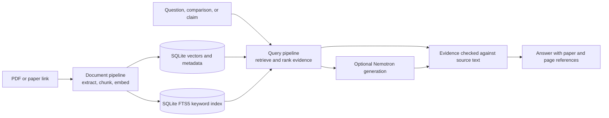

# ClaimLens — Research Paper Analyzer

ClaimLens is an AI-assisted workspace for reading, searching, and comparing research papers. Add PDFs or fetch papers by arXiv, DOI, or Semantic Scholar link, then ask questions and review answers with page-level evidence.

The project combines a local document and retrieval pipeline with optional hosted AI services. NVIDIA API Catalog provides semantic embeddings, and NVIDIA Nemotron can generate answers through Nebius Token Factory. The app also runs with local fallback providers when model keys are not configured.

## What you can do

- Upload research PDFs or fetch papers from supported scholarly links.
- Ask questions across selected papers and inspect the supporting passages and page references.
- Compare papers across research attributes such as methods, benchmarks, metrics, and results.
- Explore potential contradictions between papers.
- Check a claim against papers discovered through Semantic Scholar, arXiv, and optionally Tavily.
- Use a shared demo without signing in, or configure Firebase Authentication for user accounts.

## How it works



Every returned quote is checked against the stored source text. The app uses SQLite for document data, vectors, jobs, and the BM25 full-text index; a separate vector database service is not required for the main app.

## Technology

| Area | Technology |
| --- | --- |
| Frontend | React, TypeScript, Vite |
| API | Python, FastAPI |
| Document processing | PyMuPDF and the `document_pipeline` package |
| Search and retrieval | SQLite FTS5 BM25, dense retrieval, reranking, and the `query_pipeline` package |
| Semantic embeddings | NVIDIA API Catalog, configured through its OpenAI-compatible embeddings API |
| Answer generation | NVIDIA Nemotron through Nebius Token Factory's OpenAI-compatible API |
| Optional services | Firebase Authentication, Semantic Scholar, arXiv, Tavily |
| Deployment | Docker Compose |

NVIDIA embeddings and Nemotron are separate integrations: embeddings are called through NVIDIA API Catalog; Nemotron chat completions are called through Nebius Token Factory.

## Run with Docker

You need Docker Desktop with Docker Compose. From the repository root:

```bash
cp .env.example .env
```

On Windows PowerShell, use:

```powershell
Copy-Item .env.example .env
```

Open `.env` and add the model credentials you want to use. At minimum, set the NVIDIA API Catalog embedding values and the Nebius Token Factory values to enable hosted semantic embeddings and Nemotron answers. Then start the app:

```bash
docker compose up --build
```

Open the frontend at [http://localhost:5174](http://localhost:5174). The API is available at [http://localhost:8001](http://localhost:8001), with API documentation at [http://localhost:8001/docs](http://localhost:8001/docs).

Without model credentials, the app uses local fallback providers. Claim-check discovery can also use keyless Semantic Scholar and arXiv access; Tavily search requires `TAVILY_API_KEY`.

## Run locally

### Backend

Create and activate a Python virtual environment, then install the backend and document pipeline requirements:

```bash
python -m venv .venv
```

PowerShell activation:

```powershell
.\.venv\Scripts\Activate.ps1
```

Install dependencies and start the API from the repository root:

```bash
python -m pip install -r backend/requirements.txt -r document_pipeline/requirements.txt
python -m uvicorn backend.app.main:app --reload --port 8001
```

### Frontend

Use Node.js 20.19+ or 22.12+. In a second terminal:

```bash
cd frontend
npm install
npm run dev
```

The Vite development server runs at [http://localhost:5174](http://localhost:5174). Copy `.env.example` to `.env` at the repository root and configure any services you plan to use.

## Configuration

The complete list of settings and defaults is in [`.env.example`](.env.example). Common settings:

| Variable | Purpose |
| --- | --- |
| `EMBEDDING_BASE_URL` | Embeddings API base URL; NVIDIA API Catalog by default in the example configuration |
| `EMBEDDING_API_KEY` | NVIDIA API Catalog API key |
| `EMBEDDING_MODEL` | Embedding model ID available to your NVIDIA API Catalog account |
| `EMBEDDING_DIMENSION` | Vector size expected from the selected embedding model |
| `NEBIUS_BASE_URL` | Nebius Token Factory chat completions endpoint |
| `NEBIUS_API_KEY` | Nebius Token Factory API key |
| `NEBIUS_MODEL` | Nemotron model ID available in Token Factory |
| `SEMANTIC_SCHOLAR_API_KEY` | Optional key to increase Semantic Scholar request limits |
| `TAVILY_API_KEY` | Optional Tavily key for web search during claim checks |

Keep `.env` and Firebase service-account credentials private; do not commit secrets. The health endpoint reports which providers are active: [http://localhost:8001/api/v1/health](http://localhost:8001/api/v1/health).

### Optional Firebase sign-in

The account-free demo works without Firebase. To enable email/password, Google, and GitHub sign-in, configure a Firebase project, set the `VITE_FIREBASE_*` frontend settings and `FIREBASE_PROJECT_ID`, and provide a Firebase Admin service-account JSON file at the path set by `FIREBASE_CREDENTIALS_PATH`. See [`.env.example`](.env.example) and [`docs/api.md`](docs/api.md) for the full setup and authentication details. Never commit the service-account key.

## Repository layout

```text
backend/             FastAPI application, API routes, services, and adapters
 database/            SQLite repositories
 document_pipeline/   PDF ingestion, chunking, embeddings, and indexing
 frontend/            React and TypeScript web application
 query_pipeline/      Retrieval, ranking, evidence handling, and answer orchestration
docs/                API reference, architecture notes, and integration documents
docker/              Backend Dockerfile
docker-compose.yml    Local full-stack deployment
```

See [`docs/api.md`](docs/api.md) for API endpoints, provider behavior, and detailed architecture. The frontend has additional scripts and configuration in [`frontend/README.md`](frontend/README.md).

## License

No license file is currently included in this repository.
