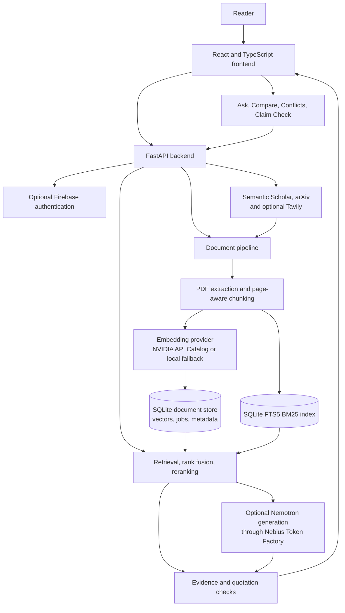

# ClaimLens — AI Research Paper Analyzer

[**Open the deployed app**](https://research-paper-analyzer-iota.vercel.app/)

ClaimLens is an AI-assisted research workspace for organizing, searching, and comparing scientific papers. It is designed for the common situation where a reader needs to answer a focused question, locate the evidence behind an answer, or compare findings across several long PDFs.

Add papers to a library by uploading PDFs or fetching supported scholarly links. Then ask questions in plain language, compare study details, look for possible disagreements, or check a claim against additional research. ClaimLens returns answers with references to the paper passages and pages used, so readers can inspect the source and judge the result for themselves.

> ClaimLens is a research aid. AI-generated analysis can be incomplete or incorrect; verify conclusions and quotations against the original papers.

## Why ClaimLens

Reading a single paper closely is already demanding. Reviewing a set of papers adds more work: locating relevant passages, keeping terminology straight, comparing methods and results, and checking whether a claim is supported by the available evidence. ClaimLens brings these tasks into one interface and makes source passages a visible part of the workflow.

The app processes PDFs into page-aware text chunks. For each question it combines semantic and keyword retrieval to find relevant passages, ranks the results, and supplies evidence to the answer workflow. When a hosted model is enabled, the generated answer can be checked against the retrieved paper text before it is returned. Readers can follow citations back to the PDF and open the cited page in the evidence viewer.

## Features

### Build a research library

- Upload one or more PDF papers and follow their processing status.
- Fetch papers with supported arXiv, DOI, and Semantic Scholar links.
- View paper details and open the original PDF from the library.
- Retry papers that fail during processing.
- Use the shared demo without signing in, or enable accounts with Firebase Authentication.

### Ask questions across papers

Select one paper or a group of papers and ask a question in natural language. ClaimLens retrieves relevant passages from the selected documents, reranks the candidates, and presents an answer with linked citations. Open a citation to inspect the matching PDF page and evidence passage.

### Compare studies

Generate a structured comparison across selected papers. The default comparison covers research attributes such as method, base model, benchmark, metric, headline result, and code availability. Values link back to their source evidence where available.

### Explore possible contradictions

Ask ClaimLens to examine selected papers for statements that may disagree on a topic. The result brings the relevant passages together so readers can compare context and interpret differences in study design, data, or conclusions.

### Check a claim against the literature

Submit a research claim for a search across Semantic Scholar and arXiv, with optional Tavily search. When suitable open-access papers are found, ClaimLens downloads and processes them, retrieves evidence, and reports whether the retrieved material supports, challenges, partially addresses, or does not provide enough evidence for the claim.

### Trace answers to source text

Answers are intended to be inspectable. Evidence includes the paper, page, and quoted passage. The backend citation guard verifies that returned quotations are present in the stored source chunk. This check helps catch unsupported quotes; it does not guarantee that an interpretation or conclusion is correct.

## NVIDIA-powered analysis

ClaimLens can use two distinct hosted model integrations:

1. **NVIDIA API Catalog embeddings** turn paper passages and user questions into vectors for semantic retrieval. The backend uses an OpenAI-compatible embeddings endpoint. The configured model's output dimension must match `EMBEDDING_DIMENSION`.
2. **NVIDIA Nemotron through Nebius Token Factory** can generate answers and support comparisons, conflict analysis, and claim judgements. The backend uses Token Factory's OpenAI-compatible chat completions endpoint.

These services are configured independently. NVIDIA API Catalog is the embedding provider; Nebius Token Factory is the endpoint used for Nemotron generation. If hosted model keys are absent, local fallback providers allow the main application workflow to run. In that mode, retrieval may use local hashing embeddings and responses use extractive or heuristic behavior, so results differ from hosted semantic models.

## Architecture



### Paper processing

The document pipeline extracts text and metadata from PDFs, detects sections, creates page-aware chunks, and prepares embeddings. The backend stores paper records, chunks, vectors, users, and background jobs in SQLite. Keyword retrieval uses SQLite FTS5 through the BM25 index. The main app does not require a separately hosted vector database.

### Question answering and workflows

The query pipeline validates requests, retrieves candidates from dense and sparse indexes, combines and reranks the candidates, balances evidence, and prepares context for generation. Ask, Compare, Conflicts, and Claim Check share retrieval and evidence-handling components. Long-running operations are represented as jobs; the frontend can show progress while they run.

### Authentication and data ownership

Firebase Authentication is optional. Without a token, requests use the shared account-free demo pool. With Firebase configured, the backend verifies the user's ID token and scopes documents and jobs to that user. Firebase service-account credentials must remain private and must not be committed to the repository.

## Technology stack

| Part | Technology |
| --- | --- |
| Web interface | React 18, TypeScript, Vite, React Router, TanStack Query |
| PDF viewing | `react-pdf` and `pdfjs-dist` |
| API | Python, FastAPI, Uvicorn |
| PDF processing | PyMuPDF and the `document_pipeline` package |
| Retrieval | Dense search, SQLite FTS5 BM25, rank fusion, reranking, and the `query_pipeline` package |
| Vector and application storage | SQLite |
| Hosted embeddings | NVIDIA API Catalog, OpenAI-compatible embeddings API |
| Hosted generation | NVIDIA Nemotron through Nebius Token Factory |
| Optional identity provider | Firebase Authentication |
| Scholarly discovery | Semantic Scholar Graph API and arXiv API |
| Optional web search | Tavily |
| Local deployment | Docker Compose |

## Getting started with Docker

Docker Compose runs the frontend and backend together. Install Docker Desktop with Compose, then clone the repository and enter its folder:

```bash
git clone https://github.com/sarveshsorte/Research-Paper-Analyzer.git
cd Research-Paper-Analyzer
cp .env.example .env
```

In PowerShell, use this instead of the last command:

```powershell
Copy-Item .env.example .env
```

Open `.env` and enter the provider credentials you intend to use. To enable hosted NVIDIA embeddings and Nemotron generation, configure the NVIDIA API Catalog and Nebius Token Factory settings described below. You can also start without hosted model keys and use the fallback providers.

Build and start the services:

```bash
docker compose up --build
```

Once the containers are ready:

- **ClaimLens web app:** [http://localhost:5174](http://localhost:5174)
- **Backend API:** [http://localhost:8001](http://localhost:8001)
- **Interactive API docs:** [http://localhost:8001/docs](http://localhost:8001/docs)
- **Provider and service health:** [http://localhost:8001/api/v1/health](http://localhost:8001/api/v1/health)

Stop the services with `Ctrl+C`. To remove the running containers while keeping the named storage volume, run `docker compose down`.

## Run locally without Docker

### Requirements

- Node.js 20.19+ or 22.12+
- Python and `pip`
- Git

### Start the backend

From the repository root, create and activate a Python virtual environment.

PowerShell:

```powershell
python -m venv .venv
.\.venv\Scripts\Activate.ps1
```

macOS or Linux:

```bash
python -m venv .venv
source .venv/bin/activate
```

Install the backend and document processing dependencies, then start the API:

```bash
python -m pip install -r backend/requirements.txt -r document_pipeline/requirements.txt
python -m uvicorn backend.app.main:app --reload --port 8001
```

The API runs at `http://localhost:8001`.

### Start the frontend

In a second terminal, from the repository root:

```bash
cd frontend
npm install
npm run dev
```

Vite serves the frontend at `http://localhost:5174`. By default, it connects to the backend on port 8001. See [`frontend/README.md`](frontend/README.md) for frontend-specific environment variables, mock mode, scripts, and interface details.

## Configure external services

Copy `.env.example` to `.env` in the repository root. It documents the available backend settings and safe defaults. Never put API keys or private credentials into committed files.

### NVIDIA API Catalog embeddings

Create or select an embeddings model in NVIDIA API Catalog and configure:

```dotenv
EMBEDDING_BASE_URL=https://integrate.api.nvidia.com/v1
EMBEDDING_API_KEY=your-nvidia-api-key
EMBEDDING_MODEL=your-available-embedding-model
EMBEDDING_DIMENSION=2048
EMBEDDING_INPUT_TYPE=auto
```

Use a model ID available to your account. Set `EMBEDDING_DIMENSION` to the dimension returned by that model; the example value is not valid for every model. `EMBEDDING_INPUT_TYPE=auto` enables NVIDIA's query/passage input type behavior when the configured URL is an NVIDIA endpoint.

### NVIDIA Nemotron through Nebius Token Factory

Create or select a Nemotron model in Nebius Token Factory and configure:

```dotenv
NEBIUS_BASE_URL=https://api.tokenfactory.us-central1.nebius.com/v1/
NEBIUS_API_KEY=your-nebius-api-key
NEBIUS_MODEL=your-available-nemotron-model
```

The model ID must match one made available in your Token Factory account. This integration uses Nebius for the chat completions request.

### Claim-check search

Semantic Scholar and arXiv can be used without API keys, although keyless Semantic Scholar requests may be rate-limited. An optional Semantic Scholar key can increase its rate limit. Set a Tavily key to enable the optional web-search source:

```dotenv
SEMANTIC_SCHOLAR_API_KEY=
TAVILY_API_KEY=your-tavily-api-key
```

Fetched PDFs are restricted to supported or allowlisted hosts. `DOWNLOAD_ALLOWED_HOSTS` can add permitted hosts as a comma-separated list; see [`docs/api.md`](docs/api.md) for download limits and safety checks.

### Optional Firebase Authentication

The account-free demo does not require Firebase. To enable user accounts:

1. Create a Firebase project and enable Email/Password, Google, and GitHub sign-in providers as needed.
2. Register a Firebase web app and add its public web configuration values to `frontend/.env`.
3. Configure the backend with `FIREBASE_PROJECT_ID` and a Firebase Admin service-account JSON file referenced by `FIREBASE_CREDENTIALS_PATH`.
4. Add local and deployed app domains to Firebase's authorized domains.

See [`.env.example`](.env.example), [`docs/api.md`](docs/api.md), and [`frontend/README.md`](frontend/README.md) for the full list of variables and setup notes. Keep the service-account JSON under the ignored `secrets/` directory or another secure location. Never commit it.

## Configuration reference

| Variable | Used for |
| --- | --- |
| `APP_ENV` | Application environment; production mode disallows fake providers |
| `STORAGE_PATH` | SQLite database for application records and vectors |
| `BM25_INDEX_PATH` | SQLite FTS5 keyword index |
| `EMBEDDING_BASE_URL` | OpenAI-compatible embeddings API base URL |
| `EMBEDDING_API_KEY` | Embedding provider credential |
| `EMBEDDING_MODEL` | Embedding model identifier |
| `EMBEDDING_DIMENSION` | Expected embedding vector size |
| `EMBEDDING_INPUT_TYPE` | NVIDIA query/passage input behavior: `auto`, `on`, or `off` |
| `NEBIUS_BASE_URL` | Nebius Token Factory chat completions API base URL |
| `NEBIUS_API_KEY` | Token Factory credential |
| `NEBIUS_MODEL` | Chat model identifier available through Token Factory |
| `SEMANTIC_SCHOLAR_API_KEY` | Optional Semantic Scholar rate-limit improvement |
| `TAVILY_API_KEY` | Optional Tavily web search for claim checks |
| `DOWNLOAD_ALLOWED_HOSTS` | Additional permitted PDF download hosts |
| `FIREBASE_PROJECT_ID` | Firebase project used for backend token verification |
| `FIREBASE_CREDENTIALS_PATH` | Firebase Admin service-account JSON path |

Additional retrieval, concurrency, and timeout settings are documented in [`.env.example`](.env.example) and [`backend/app/config.py`](backend/app/config.py).

## API overview

The API base path is `http://localhost:8001/api/v1`. The most commonly used endpoints are:

| Method | Endpoint | Purpose |
| --- | --- | --- |
| `GET` | `/health` | Check that the backend is running |
| `GET` | `/api/v1/health` | Check API and provider status |
| `POST` | `/api/v1/upload` | Upload one or more PDFs |
| `GET` | `/api/v1/documents` | List available papers |
| `POST` | `/api/v1/documents/fetch` | Fetch a supported paper link |
| `POST` | `/api/v1/query` | Ask a question about selected papers |
| `POST` | `/api/v1/compare` | Compare selected papers |
| `POST` | `/api/v1/contradiction` | Find possible conflicts between papers |
| `POST` | `/api/v1/check` | Check a claim against discovered literature |
| `GET` | `/api/v1/jobs/{id}` | Read the status or result of a background job |

See [`docs/api.md`](docs/api.md) for request and response formats, authentication behavior, error codes, external services, and the full endpoint reference. The repository also includes a [Postman collection](docs/postman/ClaimLens.postman_collection.json).

## Repository structure

```text
backend/                 FastAPI application, routes, services, and adapters
  app/
    adapters/             Bridges to the document and query pipelines
    api/routes/           Health, auth, documents, jobs, workflows, and queries
    services/             Storage, auth, jobs, provider setup, and orchestration
    schemas/              API data models
database/                 SQLite repositories
document_pipeline/       PDF ingestion, extraction, chunking, and indexing
query_pipeline/          Retrieval, ranking, evidence handling, and generation
frontend/                 React and TypeScript application
docs/                     API reference, architecture, integration notes, and Postman
 docker/                  Backend Docker image definition
docker-compose.yml        Local full-stack deployment
.env.example              Documented backend configuration template
```

## Development

The frontend provides scripts for development, build, type checking, linting, formatting, and unit tests. See [`frontend/README.md`](frontend/README.md) for details.

Backend tests are under `tests/`. Install the development and pipeline requirements, then run:

```bash
python -m pip install -r backend/requirements-dev.txt -r document_pipeline/requirements.txt
python -m pytest tests
```

The API and individual pipelines also include focused tests and service documentation. Refer to the relevant `README.md` files and documents under `docs/` before changing their interfaces.

## Troubleshooting

- **The frontend cannot reach the backend:** Check that both services are running and that the frontend API base URL points to `http://localhost:8001/api/v1`.
- **NVIDIA embeddings fail:** Confirm the API key, model ID, base URL, and embedding dimension. A model dimension mismatch prevents compatible indexing and querying.
- **Nemotron is not active:** Confirm that the Token Factory key and model ID are configured. Remember that Nemotron requests go through Nebius Token Factory.
- **Claim checks return few papers:** Keyless search services can be rate-limited, some papers are not open access, and PDF downloads are limited to supported hosts.
- **Sign-in is unavailable:** Firebase is optional. The account-free demo should still work; authenticated accounts require both frontend Firebase configuration and backend credentials.
- **A paper is still processing:** Large documents and external model calls can take time. Check the document status and backend logs for processing errors.

## Documentation

- [API, external services, and architecture](docs/api.md)
- [Frontend guide and scripts](frontend/README.md)
- [Integration map](docs/integration-map.md)
- [User journey flowchart](ResearchLens%20User%20Journey%20Flowchart.png)
- [Frontend design references](docs/design-reference/README.md)

## License

This repository does not currently include a `LICENSE` file. Add a license before redistributing or accepting contributions under terms you want to define.
